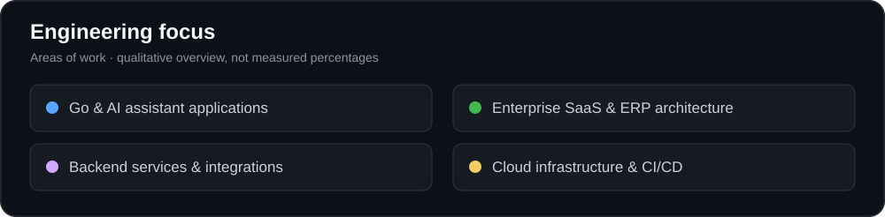
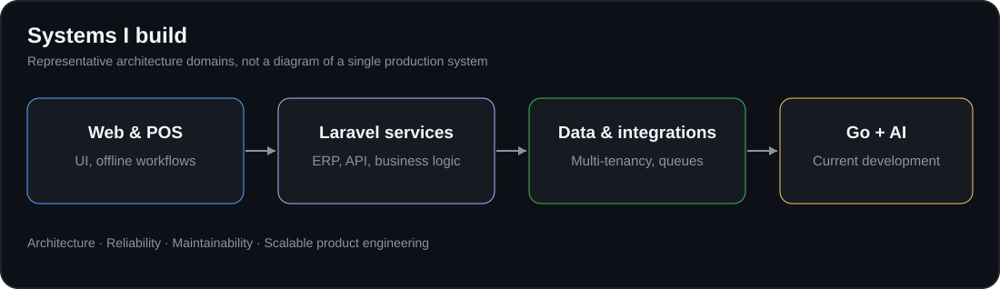

# S M Rishad

### Senior Software Engineer · Laravel & Enterprise SaaS · Backend Architecture

**Turku, Finland 🇫🇮** · **Entreform Oy** · **Currently building with Go and AI**

Building maintainable enterprise applications, multi-tenant platforms, and reliable backend systems.

---

## About Me

I'm a **Senior Software Engineer at Entreform Oy**, based in **Turku, Finland**, with **10+ years of software engineering experience**.

My strongest specialization is **PHP and Laravel**, from business-domain modeling and multi-tenant architecture to enterprise ERP systems, payment workflows, APIs, and deployment infrastructure. I have experience leading development teams and designing applications intended to evolve alongside real business needs.

Today, I'm expanding that background into **Go (Golang)** and **AI assistant-powered application development**, bringing the same engineering principles—clear boundaries, maintainable code, security, and reliability—to AI-driven software.

  

## What I Bring to Engineering Teams

| Strength | Experience |
| --- | --- |
| **Laravel engineering** | Modular application design, Eloquent, queues, jobs, REST APIs, testing, and complex business workflows |
| **SaaS architecture** | Multi-tenant applications, database isolation, feature-based modules, subscriptions, and tenant-aware services |
| **ERP & business systems** | Inventory, accounting, sales, purchasing, HRM, POS, order processing, and reporting |
| **System design** | Domain modeling, data consistency, background processing, integrations, and maintainable architecture |
| **Cloud & delivery** | Azure and AWS experience, CI/CD, Linux, deployments, and infrastructure operations |
| **Technical leadership** | Architecture decisions, reviewing implementation quality, and collaborating across engineering teams |
| **Current development** | Go backend engineering and AI assistant-powered applications |

## Primary Technical Stack

**Backend & Languages**

**Frontend & Application UI**

**Data, Cloud & Engineering**

Also experienced with **Oracle, Dart, Flutter, Tailwind CSS, DigitalOcean**, and external service integrations.

---

## Featured Engineering Work

### Enterprise SaaS & ERP Platforms — Laravel

Architecture and development work across modular, multi-tenant business platforms, including:

- **Tenant-aware systems:** isolated data, module boundaries, access control, and tenant-specific business logic.
- **Business operations:** products, contacts, sales, purchasing, inventory, accounting, HRM, bookings, and reporting.
- **Point of sale:** desktop and offline-capable POS workflows, local persistence, and data synchronization.
- **Financial consistency:** stock movements, ledger posting, returns, reconciliation, and background processing.
- **Integration & delivery:** APIs, payment providers, messaging, queues, automated tests, and cloud deployment.

*These describe areas of engineering experience and development work, not a claim that every module is publicly available or deployed.*

### Go & AI Assistant Applications — Current Focus

At **Entreform Oy**, I'm currently working on a **Go-based application with AI assistant capabilities**. My focus is on applying backend and architecture experience to intelligent application workflows.

My broader engineering interests include AI integrations, secure service boundaries, maintainable backend APIs, and connecting intelligent interfaces with real business operations.

### Additional Systems Experience

- **Restaurant and payment systems:** operational workflows, payment integration, and backend services.
- **Courier and logistics software:** delivery tracking, coordination, and process automation.
- **Trading platforms:** API integrations and data-oriented backend systems.
- **Full-stack applications:** administrative interfaces and operational tools built with modern frontend frameworks.

---

## Open Source & Public Code

I value **open-source software, reusable tools, and sharing practical engineering work**. Alongside commercial enterprise applications, I maintain a public GitHub presence with repositories covering Laravel, multi-tenancy, templating, development tooling, and application experiments.

| Repository | Area | Explore |
| --- | --- | --- |
| **multi-tenant** | Laravel and multi-tenancy research/code | [View repository](https://github.com/rishadblack/multi-tenant) |
| **TwigBridge** | Twig templating integration for Laravel; public codebase based on the TwigBridge ecosystem | [View repository](https://github.com/rishadblack/TwigBridge) |
| **cms-desktop** | CMS and desktop-style application exploration | [View repository](https://github.com/rishadblack/cms-desktop) |
| **dev-module** | Modular development tooling/code | [View repository](https://github.com/rishadblack/dev-module) |
| **rfbackup** | Public Laravel-based project repository | [View repository](https://github.com/rishadblack/rfbackup) |

**Open-source interests:** Laravel packages and extensions, modular software architecture, developer productivity, backend utilities, and practical examples that other developers can explore.

> These are links to public repositories, not a claim that I originally authored every upstream project or that each repository is a production-ready maintained package. See each repository for its current implementation, license, and history.

[**Explore all public repositories →**](https://github.com/rishadblack?tab=repositories&type=public)

---

## Architecture & Engineering Approach

  

I focus on **business correctness before complexity**, explicit domain rules, sensible abstractions, reproducible deployment, and software that other engineers can confidently maintain.

Typical concerns in my work include **multi-tenancy, authorization, transactions, asynchronous jobs, API contracts, observability, and testing**.

---

## GitHub Activity

For accurate, up-to-date GitHub activity, see my [contribution calendar and public repositories](https://github.com/rishadblack). Public GitHub contribution counts may not include all private or company work.

I intentionally avoid embedding third-party contribution cards or estimated repository statistics here; those widgets can be incomplete, misleading, or unavailable.

---

## Let's Connect

I'm interested in collaborating on **Laravel, enterprise SaaS, system architecture, Go, and AI-driven applications**.

- **Location:** Turku, Finland
- **Current employer:** Entreform Oy
- **Email:** [rishad.black@gmail.com](mailto:rishad.black@gmail.com)
- **GitHub:** [github.com/rishadblack](https://github.com/rishadblack)
